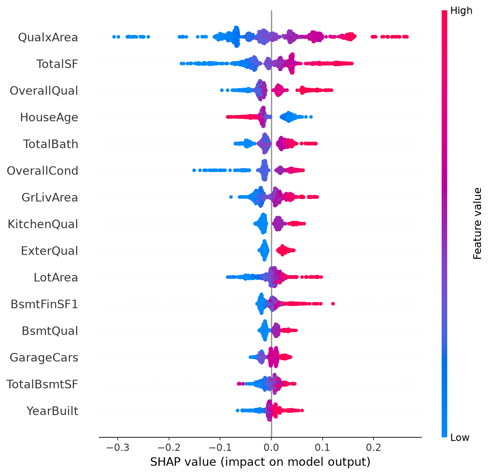

# Ames House Price Prediction: Ridge vs Random Forest vs XGBoost

Predicting house sale prices (Ames, Iowa; 1,460 houses, 79 features) with leak-free
cross-validation, feature engineering, and a written model comparison.

**Full write-up:** [reports/model_comparison.md](reports/model_comparison.md)

## Key results
Metric: RMSE on log(SalePrice) (lower is better). Test set: 292 houses, used once.

| Model | CV RMSE | Test RMSE (95% CI) | Test MAE |
|---|---|---|---|
| Ridge (tuned) | 0.1075 ± 0.0060 | 0.1269 [0.104, 0.154] | $14,323 |
| XGBoost (tuned, nested CV) | 0.1107 ± 0.0015 | 0.1242 [0.103, 0.149] | $14,393 |
| Random Forest | 0.1269 ± 0.0058 | 0.1437 [0.119, 0.172] | $16,394 |
| Blend 50/50 (not CV-validated) | n/a | 0.1221 [0.100, 0.148] | $13,740 |

## Main findings
- **Ridge and XGBoost are statistically tied;** Random Forest is clearly worst.
- Removing 2 atypical training sales cut Ridge's CV error by about 20% (0.143 to 0.113).
- Feature engineering helped XGBoost more (0.1152 to 0.1110) than Ridge; hyperparameter
  tuning barely mattered (0.1110 to 0.1107).
- Ridge and XGBoost errors correlate at 0.89, so blending helps only modestly.
- The worst test errors are mostly non-Normal sales (Partial, Alloca, Abnorml, Family).

## Method in brief
80/20 split (seed 42); all preprocessing inside sklearn Pipelines; 5-fold CV with
identical folds for every model; RidgeCV and nested Optuna for tuning; SHAP for interpretation.

## How to run
    python -m venv .venv && source .venv/bin/activate
    pip install -r requirements.txt
    jupyter lab
Run the notebooks in order (01 to 04). Python X.Y; results may differ slightly with other
library versions.

## Limitations
Small test set (CIs about ±0.025); feature sets chosen after viewing CV scores; the blend
was not CV-validated; single city and period.